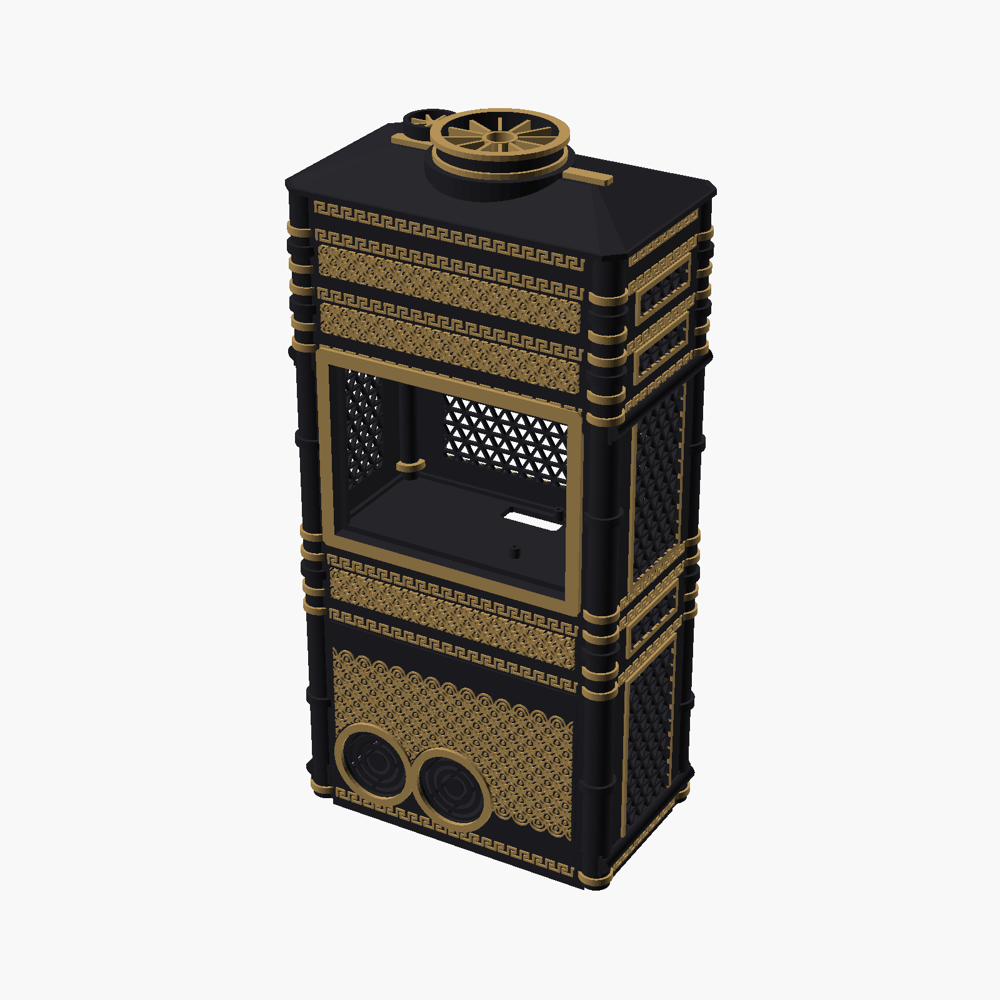

# Tower enclosure

A stackable enclosure for the whole stack, so it can sit next to the box in
the living room: Pi, 7-port hub, 5" screen, 2.5" drives and the power strip
with its bricks. Designed for resin printing on an Anycubic Photon Mono M7
(plate 223 × 126 × 230 mm); every stage fits the plate on its own.

The look: a lantern pagoda, made for a living room of katanas and dragons
rather than a grey box next to the router. Every stage has latticed windows
(asanoha, the hemp-leaf lattice) on its sides and its back, cut right
through the wall so the tower breathes through them. The two tall stages,
base and compute, get two tiers of smaller windows instead, split by a meander
band and set in fields of waves, so their walls keep the rhythm of the short
stages; the screen's bezel carries a meander too. A meander band runs
along the top and the bottom of every stage, the solid fields carry seigaiha
waves in relief, the corner posts wear three rings per stage, and the lid is
a pagoda roof with an eave and a ridge, the two exhaust stacks rising from
it like finials. Two round moon windows with ring grilles feed the base.
Every opening is a real one. The floors of the riser, hub, compute and disk
stages are latticed too (same triangle grid, 2 mm bars, solid under the
stops, the Pi standoffs and the cable pass-through), so the lid fan draws air
up through the whole tower, from the base slots to the roof.

Anthracite resin, with bronze dry-brushed on the reliefs (`renders/color.png`;
the colours are set at the top of `tower.scad`, for the renders only).
Eight colour schemes to compare are in `renders/colours/`.

## Stages, bottom to top

| Stage | Height | Holds |
| :--- | :--- | :--- |
| `base` | 130 mm | 3-outlet power strip lying flat (up to 175 × 65 × 48 mm; a Legrand extra-flat 3-way is 167 × 55 × 38), both bricks plugged in, standing up to 80 mm tall. Mains cord and Ethernet leave through two slots in the rear wall. Air comes in through the floor slots, on rubber feet. |
| `riser` | 30 mm | Empty. Slip one under any stage that needs more height, for a taller brick or a thicker drive. |
| `hub` | 34 mm | The 7-port hub, USB ports facing the rear through a slot. |
| `compute` | 124 mm | The screen, sunk in a pocket of the front face and held from inside by two `screen_clip` bars. The Pi 4 on four 14 mm standoffs at the left rear: USB and Ethernet face the middle, USB-C and micro-HDMI face the back of the screen (about 30 mm of room, so angled plugs), GPIO to the rear wall. Every cable stays inside. |
| `disk` | 32 mm | One 2.5" drive in its enclosure. Print one per drive, stack as many as needed. |
| `lid` | 18 mm + roof | Pagoda roof. 40 mm exhaust fan under the finned main stack; the smaller stack vents passively. |

Each stage has a plug underneath that drops into the stage below. A column
in each inside corner, half sunk in the walls, stands 8 mm tall at each end
of the stage with a 6 × 2 mm magnet pocket; the plug is notched around
the columns of the stage below, so column meets column and the magnets hold.
To save resin the corner conduits are hollow between the column ends, each
drained into the stage by two 2.5 mm holes, and the pagoda roof is a 3 mm
shell over the lid plate, drained by four 3 mm holes in the plate. A 36 × 14 mm pass-through at the rear of every
floor lets the cables run up and down the tower. The lattice pitch and the bands are the same on every stage, so the
ornament reads as one across the stack; the front only gets the two moon
windows, low on the base, and the screen.

Outer size: 190 × 110 mm over the pipes, about 385 mm tall with two disk stages and the stack. The footprint is set by the hub (155 mm), the strip and the screen; a disk stage is the same size as every other stage so that they stack.

## Files

- `tower.scad`: the parametric model. Open it in [OpenSCAD](https://openscad.org),
  pick a `part` at the top (or `openscad -D 'part="base"' -o base.stl tower.scad`).
  `assembly` shows the stack exploded, with ghosts of the parts to check the room.
- `stl/`: one STL per part, exported from the current parameters.
  `stl/print/` holds the same parts already oriented and tilted for the Photon
  Mono M7 plate: open them in Photon Workshop, add supports and save. Made by
  `python3 orient.py`; re-run it after re-exporting the STLs.
  Two test coupons cut from the oriented disk stage, to check supports and
  exposure for a fraction of the resin: `stl/print/disk-coupon.stl` is the low
  corner (`coupon.scad`), `stl/print/disk-coupon-high.stl` the highest corner,
  42 mm above the plate on the tallest supports (`coupon_high.scad`; a small pin
  standing on the plate beside it keeps it 26 mm up, since Workshop drops models
  to the plate when it generates supports; do not move it down). The high
  corner printed clean on 2026-10-13, so `orient.py` now tilts every part as far
  as it can while keeping its highest supported point within those 40 mm (42 with
  the Workshop lift). Only the lid cannot: roof down, the top of its eave stands
  at least 46 mm up, 50 mm as oriented. `stl/print/lid-coupon.stl`
  (`coupon_lid.scad`) is that corner, held 19 mm up by the same kind of pin.
- `step/`: the same parts as STEP (AP214), real solids for CAD tools rather than
  meshes. Made by `scad2step.py`, which runs OpenSCAD for the 2D profiles and
  [FreeCAD](https://www.freecad.org) for the solids and the export; the header of
  the script says how to run it. Re-run it after changing the model, like the STLs.
- `renders/`: reference pictures.

## Before printing

Everything is sized generously. Measure the real parts and adjust the
`components` block at the top of `tower.scad`, then re-export:

| Parameter | What to measure |
| :--- | :--- |
| `strip` | Power strip L × W × H, lying flat. The base height must be at least strip height + brick height; otherwise add a `riser`. |
| `hub` | Hub L × W × thickness. |
| `screen`, `screen_t` | Screen with its frame W × H, and the frame thickness that sits in the pocket. |
| `disk_bay` | Largest drive L × W × thickness. |
| `fan` | 40 mm fan assumed (Noctua NF-A4x10 5V PWM). |

Print settings for ABS-like resin: trays rim up, lid top down, tilted 10 to 15°
on two axes, heavy supports (Photon Workshop "Heavy": 0.55 mm tips, 1.6 mm
trunks, cross bars every 5 mm), dense under the floor pads, the columns and the
highest corner; exposure at the Workshop profile (2.2 s per 50 µm layer, 5
bottom layers at 35 s, black ABS-Like Pro 2). The first disk print, on light
supports, tore off at its highest corner.

The compute stage failed on 2026-10-14: the raft stayed on the plate but the
supports tore out of it at one end and the whole floor came out rippled. The
cause turned out to be the printer, not the part: the release film was worn and
leaking, and resin cured under it on the LCD in the exact honeycomb pattern of
the raft, so the leak was there from the first layers and every layer of that
print was exposed through a shaded screen. The hub failed the next day on the
same film. Film, screen protector and plate levelling were redone on
2026-10-24 and the high disk coupon printed clean again on 2026-10-25.

Orientation study for the compute (2026-10-25, slices every mm of
`stl/compute.stl`): rim up at 0° × 11° is the only tilt that fits the plate
(194 mm of part on 211 mm usable), and it is geometrically easier than the
disk that printed clean: highest supported point 34 mm (disk: 40, proven by
two coupons), largest layer 2 440 mm² (disk: 2 000), same floor. Standing the
stage on one end gives a vertical floor and 22 % less area per layer but 30 %
more layers, 209 mm of height on a smaller raft and supports on a decorated
lattice face; lying on a face does not fit (124 mm across 114 usable). The
tilt direction is indifferent (solid floor split 51/49 between the halves).

What the compute has that the disk had not, and what was done about it:

- Twice the layers (3 255) on the same supports, so twice the lift cycles on
  the raft-to-trunk joints where it tore. Use the `Heavy tower` support
  profile: stock Heavy tips and trunks, but a solid 1.0 mm raft and a 3 mm
  platform foot under each trunk. Keep the stock resin profile
  (`abs_like_resin_pro2@ACF@normal_print`, 2.2 s, lift 8 mm at 6 mm/s), the
  one the disk and the coupons printed on; the two-stage `@ACF@tower` lift was
  only ever run on the worn film and proves nothing.
- Overhangs 110 to 150 mm up the print that auto supports would reach with
  slender trunks from the plate: the conduit run and the top of the screen
  pocket. These now print without supports: the conduit carries a 45° keel
  underneath (`run_pipe`, also on the base), the top of the pocket and of the
  window slope up at 45° on the inside (1.5 mm of flat top kept behind the
  bezel to locate the frame; the lip the frame rests on is unchanged) and the
  upper clip bosses hang under a 45° gusset. The junction blocks sit on the
  16 mm corner conduit and barely overhang; left as they are.
- Add manual heavy supports under the four corners of the plug and every
  ~5 mm along its high edge; anchor on the part (not the plate) whatever
  Workshop still wants to support above 85 mm.

`workshop_profile.py` installs the support profiles and the `tower` resin
profile (quit Workshop first, it rewrites its files on exit). Keep the room
and the resin at 22 °C or more (the M7 has no heater; under 20 °C Anycubic
says +30 % exposure and -30 % Z speed), print from fresh resin, fill the vat
for ~300 ml and check the level once the floor is done (about 35 mm up), and
check the plate with a ruler against a light: dished plates are common on the
M7 line and fail at the centre first. Walls are 2 mm, floors 2.5 mm; the floor
slots and the floor lattice double as drain holes. The lattice openings are
about 7 mm triangles, easy to drain and to clean with a brush. The lid prints
roof down: the stacks, the eave and the fins need supports.

Print order: the stages that hold the parts first, to check the fit, the roof
last.

| # | File in `stl/print/` | Tilt | Height on the plate | Resin (without supports) | Highest supported point |
| :--- | :--- | :--- | :--- | :--- | :--- |
| 1 | `disk.stl` (printed 2026-10-13, clean) | 6° × 10°, rear low | 78 mm | 89 ml | 40 mm (proven by the coupon) |
| 2 | `disk.stl` again, for the second drive | | | 89 ml | |
| 3 | `compute.stl` (failed 2026-10-14 on the worn film), on "Heavy tower" + manual supports | 0° × 11° | 163 mm | 243 ml | 34 mm |
| 4 | `base.stl`, same recipe as the compute | 0° × 10° | 166 mm | 254 ml | 31 mm |
| 5 | `hub.stl` (printed 2026-10-24 on the new film, rough under the floor but in use) | 4° × 11°, rear low | 80 mm | 85 ml | 40 mm |
| 6 | `lid-coupon.stl` | as the lid | 54 mm | 24 ml | 50 mm |
| 7 | `lid.stl`, once the coupon is clean, on "Heavy tower" | 0° × 10°, roof down | 73 mm | 193 ml | 50 mm |
| – | `screen_clip.stl` × 2 | 15° × 13° | 42 mm | 4 ml each | small, any support |
| – | `riser.stl`, only if a stage lacks height | 6° × 10°, rear low | 77 mm | 84 ml | 40 mm |

The base and the compute stage are too wide to tilt across the plate at all,
but their supports stay lower than the disk's; they are the tallest and the
heaviest prints, which is why they come last. Count about 1 l of resin for the
standard tower, plus 20 to 30 % for the supports.

## Hardware

- 40 magnets 6 × 2 mm for the standard stack (8 per joint: 4 at the top of the
  stage below, 4 at the bottom of the stage above; 4 more per extra stage), glued
  with the poles checked; or half of them replaced by 6 × 2 mm steel discs
- 4 M2.5 × 6 screws for the Pi, 4 M3 × 8 for the screen clips, 4 M3 × 20 for the fan
- 4 self-adhesive rubber feet, 12 mm
- Noctua NF-A4x10 5V PWM fan, driven from the Pi GPIO
- Short cables: micro-HDMI to HDMI and USB-C (Pi power), both with a 90° plug at the Pi end; USB-A to micro-USB (screen)
- Optional: a 5 V addressable LED strip (WS2812) on the Pi GPIO, stuck inside behind the louvres
